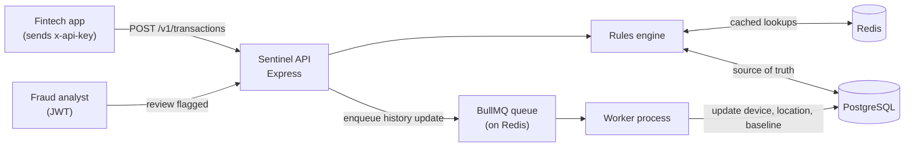
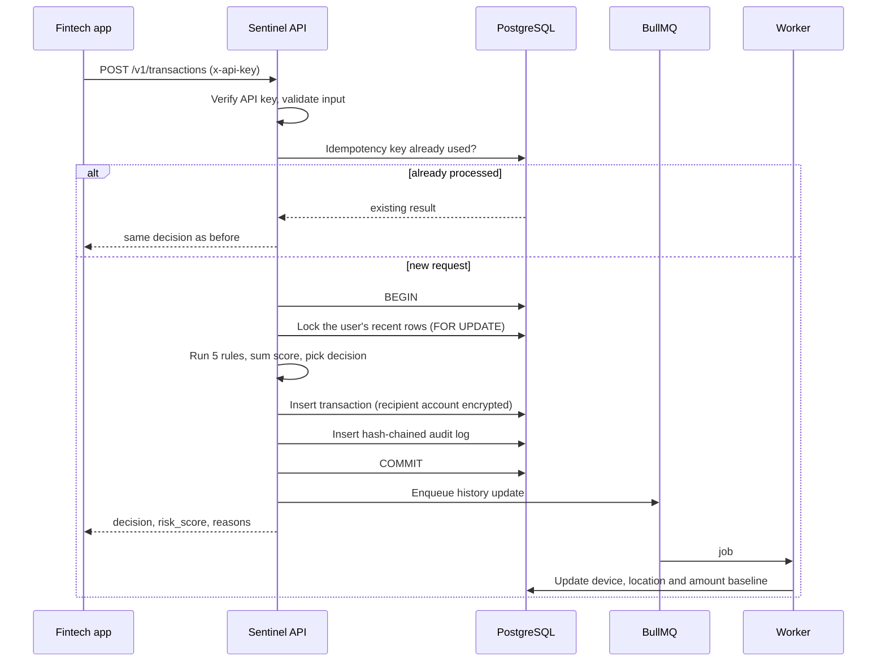
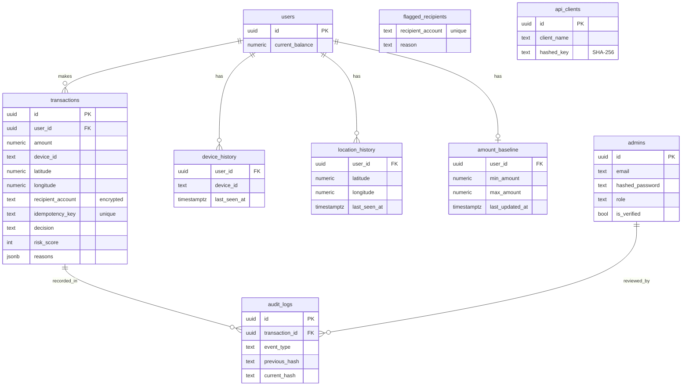

# Sentinel

A real-time transaction fraud-scoring API. A fintech or payment app sends Sentinel the details of a payment attempt, and Sentinel answers **before the money moves** with one of three decisions: `approve`, `challenge` or `block`, plus a risk score and the reasons behind it.

Sentinel never touches money and never handles end-user logins. It only judges the data it is given. Device ID, GPS coordinates and balance are collected by the calling app, which is the only party with access to the phone.

**Stack:** Node.js, Express, PostgreSQL, Redis, BullMQ, Jest

## Documentation

The full design lives in [SYSTEM_DESIGN.md](SYSTEM_DESIGN.md).

## Architecture



The decision path is synchronous and fast. Slower bookkeeping (updating a user's known devices, locations and spending range) is pushed to a background worker after the response is sent.

## Request flow



## Risk scoring

Each rule adds points when it triggers. The weights are set so that any single rule forces at least a challenge, and stacked signals escalate to a block.

| Rule | Triggers when | Points |
|---|---|---|
| Unknown device | Device not seen for this user in the last 10 months | 45 |
| Unusual location | No known location within 50 km seen in the last 10 months | 45 |
| Unusual amount | Outside the user's personal min/max range (skipped for new users or a stale baseline, older than 6 months) | 45 |
| Velocity | 5 or more transactions in 15 minutes, or more than 20% of balance moved in 6 hours | 45 |
| Flagged recipient | Recipient account is on the fraud list | 90 |

| Total score | Decision |
|---|---|
| 0 to 40 | `approve` |
| 41 to 80 | `challenge` (the calling app should ask the user for extra verification) |
| 81 and above | `block` |

## Data model



## Security and reliability

- **Two kinds of caller, two kinds of auth.** Fintech clients authenticate with an API key (stored as a SHA-256 hash). Fraud analysts log in with email and password (bcrypt) and receive a JWT. Admin routes check the token and the `admin` role.
- **Admin onboarding.** No public admin registration. The first admin is created by a bootstrap script that reads credentials from environment variables, and every admin must verify their email with a code that expires after 15 minutes.
- **Encryption at rest.** `recipient_account` is stored with AES-256-CBC and decrypted only when an authenticated admin reads it.
- **Idempotency.** Retrying a request with the same `idempotencyKey` returns the original decision instead of processing it twice. A unique database constraint backs this up.
- **Concurrency control.** The velocity check and the insert run inside one database transaction that locks the user's recent rows, so simultaneous requests from a user with recent activity are serialized. A user with no recent rows is not yet covered (see [reliability](docs/07-reliability-and-performance.md#3-concurrency-control)).
- **Tamper-evident audit log.** Each entry stores a SHA-256 hash of its own data plus the previous entry's hash, so editing an old record breaks the chain.
- **Caching.** Device, location, baseline and flagged-recipient lookups are cached in Redis for 1 hour. Velocity checks are never cached because they need fresh data. The tradeoff is that a cached answer can be up to an hour stale.
- **SQL injection.** Every query uses parameterized placeholders. No input is concatenated into SQL.

## API

| Method | Path | Auth | Purpose |
|---|---|---|---|
| POST | `/v1/transactions` | API key | Score a transaction and return a decision |
| GET | `/v1/transactions/:id` | Admin JWT | Fetch one transaction |
| GET | `/v1/flagged` | Admin JWT | List challenged and blocked transactions |
| POST | `/v1/flagged/:id/review` | Admin JWT | Override a decision |
| GET | `/v1/users/:id/risk-profile` | Admin JWT | Baseline and flag counts for a user |
| POST | `/v1/admin/verify` | Public | Verify an admin email with the emailed code |
| POST | `/v1/admin/login` | Public | Exchange email and password for a JWT |

Example request and response:

```json
POST /v1/transactions
x-api-key: <client key>

{
  "userId": "b74b9480-406a-4bd1-b268-acf79a60e516",
  "amount": 200,
  "deviceId": "device-abc123",
  "latitude": 6.5244,
  "longitude": 3.3792,
  "recipientAccount": "acct-xyz",
  "currentBalance": 5000,
  "idempotencyKey": "order-8841"
}
```

```json
{
  "transaction_id": "58dc1373-c8d9-411e-ab36-b81c5d8e0d60",
  "decision": "challenge",
  "risk_score": 45,
  "reasons": ["unknown_device"]
}
```

## Running locally

Requires Node.js, PostgreSQL and Redis running locally.

```bash
npm install

# .env needs: DATABASE_URL, ENCRYPTION_KEY (32 bytes as 64 hex chars), JWT_SECRET,
# REDIS_HOST, REDIS_PORT, EMAIL_USER, EMAIL_PASS, ADMIN_EMAIL, ADMIN_PASSWORD

npx node-pg-migrate up                      # create the tables
node scripts/bootstrap_admin.js             # create the first admin, emails a verification code
node scripts/api_client.js "My Client"      # create an API client, prints the key once

nodemon server.js                           # terminal 1: the API
node Queue/startWorker.js                   # terminal 2: the background worker
```

## Tests

```bash
npx jest
```

The rules engine is unit tested with a mocked database and mocked Redis, covering each rule, the thresholds and stacked-signal escalation.

## Known limitations and next steps

Written down so they are decisions, not surprises.

- **Challenge confirmation flow is designed but not built.** The plan: the calling app runs its own verification (fingerprint, OTP) and reports pass or fail to `POST /v1/transactions/:id/confirm`, with 5 attempts per transaction, a 30-minute account cooldown after that, and escalation to admin review on repeat cooldowns.
- **No rate limiting.** The 6-digit email verification code and the login route can be brute-forced. Rate limiting was deliberately deferred.
- **The review route trusts `reviewedBy` from the request body.** It should come from the verified JWT and be written to `audit_logs.admin_id`.
- **No audit-chain verification tool yet.** Entries are hash-chained, but there is no endpoint or script that walks the chain and reports tampering.
- **Cold start.** Sentinel only knows what has passed through it. A user's first device and location are accepted and learned (trust on first use); later activity is judged against that history. Rules that need a baseline are skipped until one exists.
- **Planned:** role tiers for admins (analyst vs senior), data masking by role, API versioning beyond the `/v1` path prefix, and integration tests with Supertest.