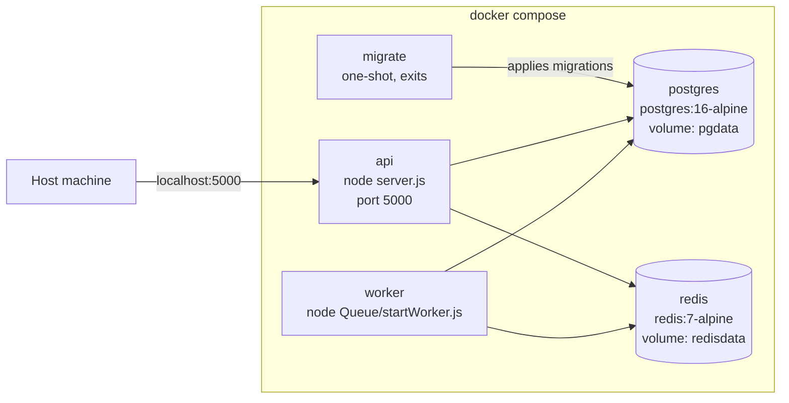
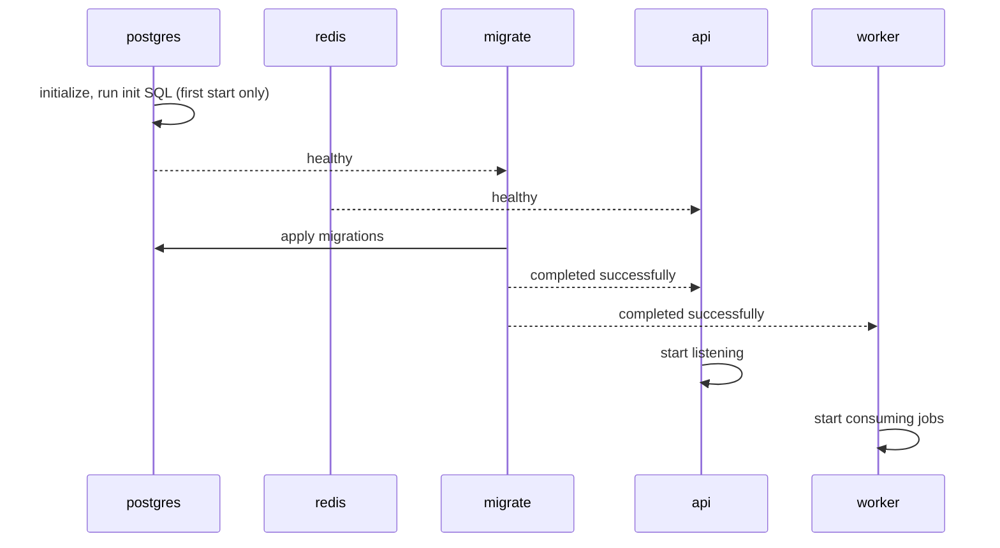

# 11. Deployment and Docker

[← Back to index](../SYSTEM_DESIGN.md) · Previous: [Known limitations and roadmap](10-known-limitations-and-roadmap.md)

> **Status:** configuration provided. It is pending its first full verification run; use the checklist in section 9 and update this note when it passes.

## 1. Overview

Sentinel is packaged as **one Docker image** used by three services (API, worker, migration job), alongside official PostgreSQL and Redis images. One command starts the whole system.

## 2. Topology



Only the API publishes a port. PostgreSQL and Redis are reachable **only from inside the Compose network**, which keeps them off the host and the internet.

## 3. Files

| File | Purpose |
|---|---|
| `Dockerfile` | Builds the Node image: installs production dependencies, runs as the unprivileged `node` user |
| `docker-compose.yml` | Defines the five services, their order, volumes and health checks |
| `.dockerignore` | Keeps `.env`, `.git`, `node_modules`, tests and docs out of the image |
| `docker/postgres-init/00-extensions.sql` | Enables `uuid-ossp` when the database is first created |
| `.env.example` | Template for the required environment variables |

## 4. Services

| Service | Image | Command | Role |
|---|---|---|---|
| `postgres` | `postgres:16-alpine` | default | Source of truth. Data persists in the `pgdata` volume. |
| `redis` | `redis:7-alpine` | `redis-server --appendonly yes` | Cache and job queue. Append-only file keeps queued jobs across restarts. |
| `migrate` | `sentinel:local` | `node-pg-migrate up` | Applies pending migrations, then exits |
| `api` | `sentinel:local` | `node server.js` | Serves HTTP on port 5000 |
| `worker` | `sentinel:local` | `node Queue/startWorker.js` | Processes history-update jobs |

### Startup order



`depends_on` with health conditions guarantees the database accepts connections before migrations run, and that the API and worker only start after the schema exists.

## 5. Design choices

| Choice | Reason |
|---|---|
| One image, three roles | The API, worker and migration job share the same code and dependencies. Building once avoids drift. |
| Migrations as a separate one-shot service | They run to completion before the app starts, and never race with each other if the API is later scaled |
| Init SQL for `uuid-ossp` | The migration that enables the extension has a later timestamp than the tables that need it. On a **fresh** database the first table would fail. Creating the extension at database initialization removes that ordering problem. |
| Service names as hostnames | Inside Compose, `postgres` and `redis` resolve to the containers. `DATABASE_URL` and `REDIS_HOST` are overridden in the Compose file. |
| `.env` not baked into the image | Secrets are injected at run time through `env_file`. `.dockerignore` excludes them from the image. |
| Non-root user | A compromised process has fewer privileges |
| No published ports for Postgres or Redis | Smaller attack surface |
| `npm ci --omit=dev` | Reproducible install from the lockfile, without test tooling in the image |

## 6. Environment variables

Copy `.env.example` to `.env` and fill it in.

| Variable | Purpose | Notes |
|---|---|---|
| `POSTGRES_PASSWORD` | Password for the Postgres container | Also used to build `DATABASE_URL`. If it contains special characters, URL-encode them. |
| `ENCRYPTION_KEY` | AES-256 key for `recipient_account` | 64 hex characters |
| `JWT_SECRET` | Signs admin tokens | Long and random |
| `EMAIL_USER`, `EMAIL_PASS` | SMTP login for verification emails | Gmail app password |
| `ADMIN_EMAIL`, `ADMIN_PASSWORD` | First admin | Read by the bootstrap script |
| `DATABASE_URL`, `REDIS_HOST`, `REDIS_PORT` | Connection settings | **Set by Compose**; only needed when running without Docker |

## 7. Running it

```bash
cp .env.example .env

docker compose up --build -d    

docker compose run --rm api node scripts/bootstrap_admin.js
docker compose run --rm api node scripts/api_client.js "My Client"
```

The bootstrap script emails a verification code. Then verify and log in through the API as described in [API design](05-api-design.md).

Everyday commands:

| Task | Command |
|---|---|
| See running services | `docker compose ps` |
| Follow API logs | `docker compose logs -f api` |
| Follow worker logs | `docker compose logs -f worker` |
| Stop, keep data | `docker compose down` |
| Stop and **wipe all data** | `docker compose down -v` |
| Rebuild after code changes | `docker compose up --build -d` |

The init SQL only runs when the database volume is empty, so after `down -v` it runs again on the next start.

## 8. Running on a low-memory machine

Docker Desktop on Windows reserves a large virtual machine and is the heaviest part of the setup. On a machine with 4 GB of RAM:

- Prefer **Docker Engine installed inside the WSL Ubuntu distribution** over Docker Desktop.
- Close other heavy applications while the stack runs.
- The containers themselves are small: Postgres, Redis and two Node processes are modest. The overhead is the Docker layer, not Sentinel.
- If memory is still tight, run PostgreSQL and Redis as normal local services and keep using Docker only for the image build and demos on another machine.

## 9. Verification checklist

- [ ] `docker compose up --build -d` finishes without errors
- [ ] `docker compose ps` shows `postgres`, `redis`, `api` and `worker` running, and `migrate` exited with code 0
- [ ] `docker compose logs migrate` shows all migrations applied
- [ ] `curl -i http://localhost:5000/v1/transactions -X POST` returns **401** (route is protected and reachable)
- [ ] `bootstrap_admin.js` creates the admin and the email arrives
- [ ] `api_client.js` prints a key
- [ ] A scored transaction returns a decision
- [ ] `docker compose logs worker` shows the history update completing
- [ ] `docker compose down` then `up -d` again keeps the data

## 10. Limitations

| Item | Detail |
|---|---|
| Local-development grade | Default passwords and a single Postgres instance are suitable for demos, not production |
| No TLS | HTTPS termination belongs in front of the API (a reverse proxy or the hosting platform) |
| No API health endpoint | Compose cannot yet check the API itself, only its dependencies |
| Secrets via `env_file` | Acceptable locally. A deployed system should use a secrets manager. |
| Single replica each | No scaling, failover or backups configured |
| Not yet verified | See the checklist above |