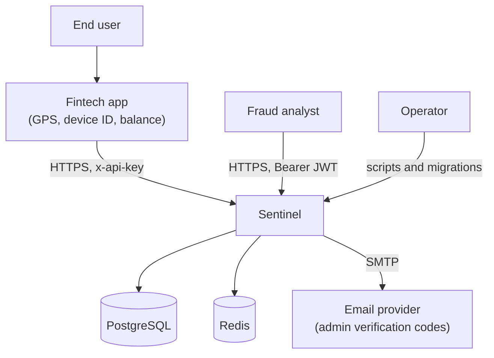
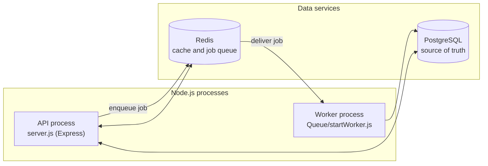
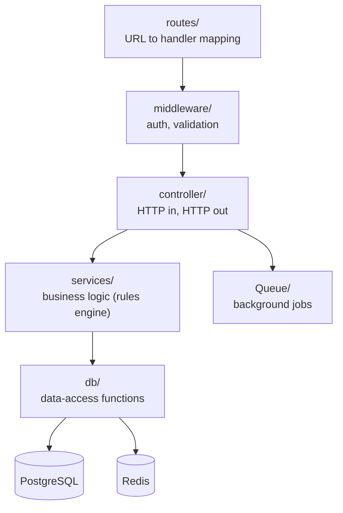
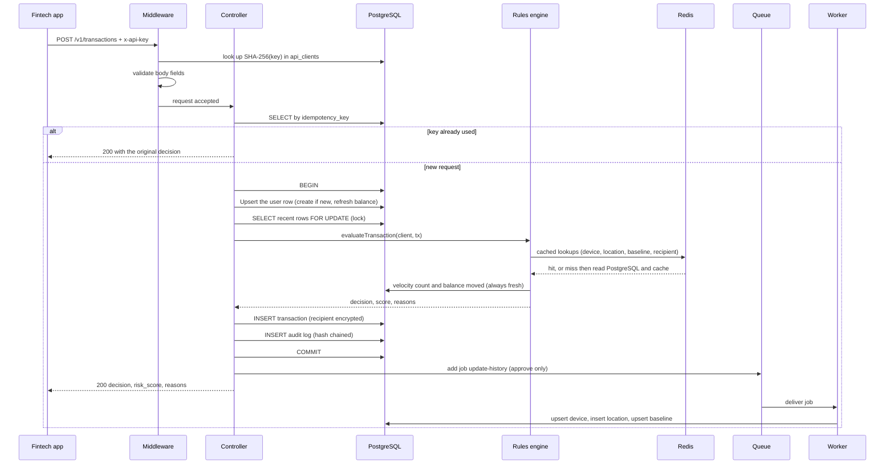
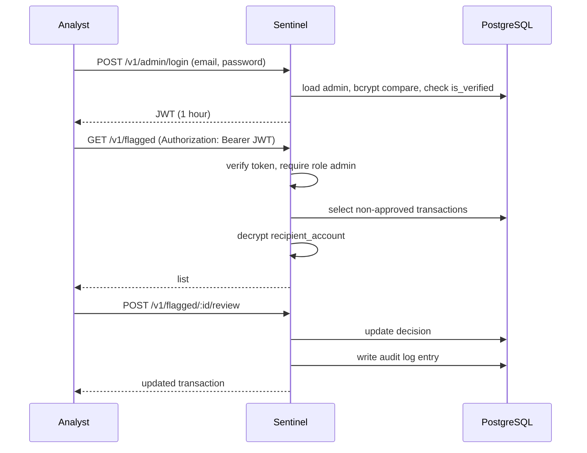

# 02. Architecture

[← Back to index](../SYSTEM_DESIGN.md) · Previous: [Requirements](01-requirements-and-scope.md) · Next: [Risk engine →](03-risk-engine-design.md)

## 1. Overview

Sentinel is a small, layered Node.js service. It runs as **two processes** (the API and a background worker) that share two pieces of infrastructure (PostgreSQL and Redis).

## 2. System context

Who talks to Sentinel, and what Sentinel depends on.



## 3. Containers (what actually runs)



| Container | Responsibility | Start command |
|---|---|---|
| API process | Serves HTTP, authenticates, scores transactions, enqueues history updates | `nodemon server.js` |
| Worker process | Consumes history-update jobs and writes device, location and baseline data | `node Queue/startWorker.js` |
| PostgreSQL | Permanent data: users, transactions, history, audit log, admins, clients | Service |
| Redis | Fast cache for repeated lookups, and the storage engine behind BullMQ | Service |

Redis does double duty: it is both the cache and the queue backend. One installation, two jobs.

## 4. Layered structure



**Layering rule:** each layer calls only the layer below it. The rules engine knows nothing about HTTP, requests or responses. It takes plain data in and returns a decision. That is what makes it testable in isolation (see [Testing](08-testing-strategy.md)).

### Project structure

```
sentinel/
├── server.js                    # Express app setup, route mounting, listen
├── config/
│   ├── db.js                    # PostgreSQL connection pool
│   └── redis.js                 # Redis client
├── routes/
│   ├── transaction.js           # transaction and admin-review endpoints
│   └── admin.js                 # admin verify and login endpoints
├── middleware/
│   ├── auth.js                  # JWT check and role check (admins)
│   ├── Api_auth.js              # API-key check (fintech clients)
│   └── validateTransaction.js   # request body validation
├── controller/
│   └── transactionController.js # orchestrates one scoring request
├── services/
│   └── riskEngine.js            # evaluateTransaction(): the five rules
├── db/
│   ├── deviceHistory.js         # isDeviceKnown (cached)
│   ├── locationHistory.js       # isLocationKnown (cached, Haversine)
│   ├── amountBaseline.js        # getAmountBaseline (cached)
│   ├── flaggedRecipients.js     # isRecipientFlagged (cached)
│   ├── transactions.js          # insertTransaction, velocity queries
│   └── auditLogs.js             # writeAuditLog (hash chain)
├── Queue/
│   ├── historyQueue.js          # producer side of the queue
│   ├── Worker.js                # consumer: updates history tables
│   └── startWorker.js           # entry point for the worker process
├── utils/
│   ├── distance.js              # Haversine distance
│   └── encryption.js            # AES-256-CBC encrypt and decrypt
├── scripts/
│   ├── bootstrap_admin.js       # creates the first admin and emails a code
│   ├── api_client.js            # creates a fintech API client and prints its key
│   └── admin_credentials.js     # Nodemailer transport and sendEmail()
├── migrations/                  # node-pg-migrate files, run in timestamp order
└── tests/
    └── riskEngine.test.js       # Jest unit tests
```

## 5. Request lifecycle: scoring a transaction



Key properties of this flow:

- **Everything between `BEGIN` and `COMMIT` uses one dedicated connection**, so the lock holds and the work is atomic.
- **If anything fails, `ROLLBACK`** undoes the whole attempt and the client receives a 500. No half-saved transaction can exist.
- **The queue is touched only after `COMMIT`**, so a job is never created for a transaction that was rolled back.
- **The response is sent without waiting for the worker.**

## 6. Request lifecycle: admin actions



## 7. Data ownership

| Data | Owner | Notes |
|---|---|---|
| Device ID, GPS, amount, balance, recipient | **Calling app** | Sentinel trusts but cannot verify |
| Decision, score, reasons | **Sentinel** | Derived and stored |
| Per-user device, location and amount history | **Sentinel** | Learned only from transactions that pass through it |
| Flagged recipient list | **Sentinel** | Maintained by operators and analysts |
| Biometric or OTP verification | **Calling app** | Sentinel receives only pass or fail |

## 8. Technology choices

| Concern | Choice | Why |
|---|---|---|
| Runtime and framework | Node.js, Express 5 | Familiar, fast to build, good async I/O for lookup-heavy work |
| Database | PostgreSQL | Relational data with real ACID transactions and row-level locking, which the concurrency objective needs |
| DB access | `pg` driver with raw SQL, no ORM | Full control and visibility, and deliberate practice with SQL |
| Migrations | `node-pg-migrate` | Versioned, ordered, reversible schema changes in JavaScript |
| Cache | Redis via `ioredis` | In-memory speed for lookups repeated on every transaction |
| Queue | BullMQ | Built on Redis, so no extra infrastructure |
| Passwords | `bcrypt` | Slow by design; suited to passwords |
| Tokens | `jsonwebtoken` | Standard signed tokens for admin sessions |
| Email | Nodemailer over SMTP | Simple verification codes without a managed email service |
| Tests | Jest, Supertest | Standard Node testing; Supertest reserved for HTTP-level tests |

## 9. Cross-cutting concerns

| Concern | Approach |
|---|---|
| Configuration | Environment variables loaded from `.env`; never committed |
| Errors | `try/catch` in handlers; transactional rollback in the controller; generic 500 message to clients, full error to the server log |
| Logging | `console` only |
| Time | All timestamps are `TIMESTAMPTZ`; decay windows computed against server time |
| Identity | UUIDs for every primary key |
| Versioning | `/v1` path prefix on every route |