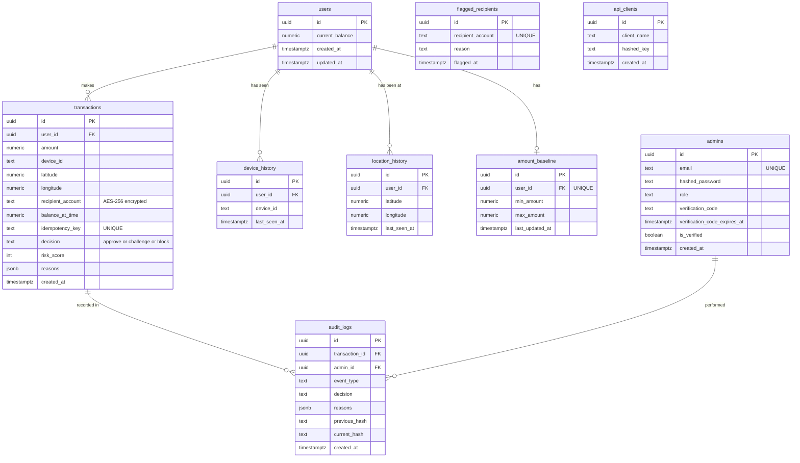

# 04. Database Design

[← Back to index](../SYSTEM_DESIGN.md) · Previous: [Risk engine](03-risk-engine-design.md) · Next: [API design →](05-api-design.md)

## 1. Overview

PostgreSQL is the **single source of truth**. It was chosen over a document or key-value store because the data is relational (a transaction belongs to a user; an audit entry belongs to a transaction), and because the project needs real ACID transactions and row-level locking for concurrency control.

There are **9 tables**, created and evolved through versioned migrations.

## 2. Entity-relationship diagram



`flagged_recipients`, `admins` and `api_clients` stand alone. They are looked up by value, not linked by foreign keys.

## 3. Conventions

| Convention | Choice | Reason |
|---|---|---|
| Primary keys | `UUID`, generated by `uuid_generate_v4()` (extension `uuid-ossp`) | Unguessable, safe to expose in URLs |
| Money | `NUMERIC(14,2)` | Exact decimal arithmetic. Floating point is unsafe for money. |
| Coordinates | `NUMERIC(9,6)` | About 10 cm of precision, exact storage |
| Timestamps | `TIMESTAMPTZ` | Time-zone aware. Decay logic compares times, so ambiguity would cause bugs. |
| Flexible lists | `JSONB` (`reasons`) | A variable-length list of rule names, queryable if needed |
| Naming | `snake_case` tables and columns | PostgreSQL convention |

## 4. Table reference

### 4.1 `users`

The people Sentinel has history for. Sentinel stores only what scoring needs: no names, emails or passwords.

| Column | Type | Constraints | Notes |
|---|---|---|---|
| `id` | UUID | PK | The calling app's user identifier |
| `current_balance` | NUMERIC(14,2) | NOT NULL, default 0 | Supplied by the caller |
| `created_at`, `updated_at` | TIMESTAMPTZ | NOT NULL, default now() | |

### 4.2 `transactions`

One row per scored attempt: the permanent record of every decision.

| Column | Type | Constraints | Notes |
|---|---|---|---|
| `id` | UUID | PK | |
| `user_id` | UUID | NOT NULL, FK to `users`, `ON DELETE CASCADE` | |
| `amount` | NUMERIC(14,2) | NOT NULL | |
| `device_id` | TEXT | NOT NULL | |
| `latitude`, `longitude` | NUMERIC(9,6) | NOT NULL | |
| `recipient_account` | TEXT | NOT NULL | **Stored encrypted** (`iv:ciphertext`, hex) |
| `balance_at_time` | NUMERIC(14,2) | NOT NULL | Snapshot of `currentBalance` at the moment of the attempt |
| `idempotency_key` | TEXT | UNIQUE | Backs up the application-level duplicate check |
| `decision` | TEXT | NOT NULL, CHECK in (`approve`,`challenge`,`block`) | The database itself rejects any other value |
| `risk_score` | INTEGER | NOT NULL | |
| `reasons` | JSONB | NOT NULL, default `[]` | Triggered rule names |
| `created_at` | TIMESTAMPTZ | NOT NULL, default now() | |

Index: `(user_id, created_at)`. This serves the velocity queries ("this user's transactions in the last N minutes").

### 4.3 `device_history`

| Column | Type | Constraints |
|---|---|---|
| `id` | UUID | PK |
| `user_id` | UUID | NOT NULL, FK to `users`, `ON DELETE CASCADE` |
| `device_id` | TEXT | NOT NULL |
| `last_seen_at` | TIMESTAMPTZ | NOT NULL, default now() |

Unique index on `(user_id, device_id)`: one row per device per user. The worker refreshes `last_seen_at` with an upsert instead of creating duplicates.

### 4.4 `location_history`

| Column | Type | Constraints |
|---|---|---|
| `id` | UUID | PK |
| `user_id` | UUID | NOT NULL, FK to `users`, `ON DELETE CASCADE` |
| `latitude`, `longitude` | NUMERIC(9,6) | NOT NULL |
| `last_seen_at` | TIMESTAMPTZ | NOT NULL, default now() |

Index on `user_id`. Unlike devices, locations are **many rows per user**: a history of places. Distance math runs in application code, since plain Postgres cannot index "within N km" without an extension.

### 4.5 `amount_baseline`

| Column | Type | Constraints |
|---|---|---|
| `id` | UUID | PK |
| `user_id` | UUID | NOT NULL, **UNIQUE**, FK to `users`, `ON DELETE CASCADE` |
| `min_amount` | NUMERIC(14,2) | NOT NULL |
| `max_amount` | NUMERIC(14,2) | NOT NULL |
| `last_updated_at` | TIMESTAMPTZ | NOT NULL, default now() |

Exactly **one row per user**. The unique constraint on `user_id` is required: the worker writes this table with `INSERT ... ON CONFLICT (user_id)`, which only works if that constraint exists. It was added by a follow-up migration.

### 4.6 `flagged_recipients`

| Column | Type | Constraints |
|---|---|---|
| `id` | UUID | PK |
| `recipient_account` | TEXT | NOT NULL, UNIQUE |
| `reason` | TEXT | |
| `flagged_at` | TIMESTAMPTZ | NOT NULL, default now() |

Global, not per user. The unique constraint gives an instant indexed lookup.

> **Note on encryption.** `transactions.recipient_account` is stored encrypted, while this list stores plain account numbers so it can be matched. Matching an encrypted value would need deterministic encryption or a keyed hash. Recording this as a design inconsistency to resolve later.

### 4.7 `audit_logs`

| Column | Type | Constraints | Notes |
|---|---|---|---|
| `id` | UUID | PK | |
| `transaction_id` | UUID | FK to `transactions`, `ON DELETE SET NULL` | Audit records must survive even if a transaction row is removed |
| `admin_id` | UUID | FK to `admins`, `ON DELETE SET NULL` | Added later; to be populated on admin actions |
| `event_type` | TEXT | NOT NULL | `decision`, `admin_review`, `verification_attempt` |
| `decision` | TEXT | | |
| `reasons` | JSONB | | Renamed from `reason` for consistency with `transactions` |
| `previous_hash` | TEXT | | Hash of the preceding entry (`genesis` for the first) |
| `current_hash` | TEXT | NOT NULL | SHA-256 of this entry plus `previous_hash` |
| `created_at` | TIMESTAMPTZ | NOT NULL, default now() | |

Index on `transaction_id`. See [Security design](06-security-design.md#7-tamper-evident-audit-log) for the chain algorithm.

### 4.8 `admins`

| Column | Type | Constraints | Notes |
|---|---|---|---|
| `id` | UUID | PK | |
| `email` | TEXT | NOT NULL, UNIQUE | |
| `hashed_password` | TEXT | NOT NULL | bcrypt, cost 12 |
| `role` | TEXT | NOT NULL, default `admin` | Allows tiers later |
| `verification_code` | TEXT | | Six digits; cleared once used |
| `verification_code_expires_at` | TIMESTAMPTZ | | Fifteen minutes after issue |
| `is_verified` | BOOLEAN | default false | Login requires true |
| `created_at` | TIMESTAMPTZ | NOT NULL, default now() | |

### 4.9 `api_clients`

| Column | Type | Constraints | Notes |
|---|---|---|---|
| `id` | UUID | PK | |
| `client_name` | TEXT | NOT NULL | Human label for the integrating company |
| `hashed_key` | TEXT | NOT NULL | SHA-256 of the raw key. The raw key is never stored. |
| `created_at` | TIMESTAMPTZ | NOT NULL, default now() | |

`hashed_key` is the lookup column on every authenticated request, so it should carry a **unique index**.

## 5. Relationships and deletion behavior

| Relationship | On delete | Reasoning |
|---|---|---|
| `users` → `transactions`, `device_history`, `location_history`, `amount_baseline` | `CASCADE` | History is meaningless without its user |
| `transactions` → `audit_logs` | `SET NULL` | **Never lose an audit record**, even if its transaction is removed |
| `admins` → `audit_logs` | `SET NULL` | Same reasoning |

## 6. Key queries

| Purpose | SQL shape |
|---|---|
| Idempotency check | `SELECT * FROM transactions WHERE idempotency_key = $1` |
| Lock for concurrency | `SELECT id FROM transactions WHERE user_id = $1 AND created_at >= NOW() - INTERVAL '15 minutes' FOR UPDATE` |
| Device known | `SELECT last_seen_at FROM device_history WHERE user_id = $1 AND device_id = $2` |
| Locations for a user | `SELECT latitude, longitude, last_seen_at FROM location_history WHERE user_id = $1` |
| Baseline | `SELECT min_amount, max_amount, last_updated_at FROM amount_baseline WHERE user_id = $1` |
| Velocity count | `SELECT COUNT(*) AS count FROM transactions WHERE user_id = $1 AND created_at >= NOW() - INTERVAL '1 minute' * $2` |
| Balance moved | `SELECT COALESCE(SUM(amount), 0) AS total FROM transactions WHERE user_id = $1 AND created_at >= NOW() - INTERVAL '1 hour' * $2` |
| Flagged recipient | `SELECT ... FROM flagged_recipients WHERE recipient_account = $1` |
| Device upsert | `INSERT ... ON CONFLICT (user_id, device_id) DO UPDATE SET last_seen_at = NOW()` |
| Baseline upsert | `INSERT ... ON CONFLICT (user_id) DO UPDATE SET min_amount = LEAST(...), max_amount = GREATEST(...), last_updated_at = NOW()` |
| Flagged list | `SELECT ... FROM transactions WHERE decision != 'approve' ORDER BY created_at DESC` |

Notes:

- `COALESCE(SUM(...), 0)` is essential. `SUM` over zero rows returns `NULL`, not `0`, and a `NULL` comparison silently misbehaves.
- Every query uses `$1, $2` placeholders. None builds SQL from strings.

## 7. Migrations

Schema changes are versioned files in `migrations/`, named with a timestamp prefix. `node-pg-migrate` runs them in ascending timestamp order and records each in a `pgmigrations` table.

```
npx node-pg-migrate up      # apply pending migrations
npx node-pg-migrate down    # undo the most recent
```

History of schema changes:

| Step | Change |
|---|---|
| Initial | Nine tables, indexes, CHECK constraint on `decision` |
| Fix | Timestamp columns standardized to `TIMESTAMPTZ`; `amount_baseline.min_amount` made NOT NULL; `audit_logs.reason` renamed `reasons` |
| Admin work | `admins.role`, `audit_logs.admin_id` |
| Email verification | `admins.verification_code`, `is_verified` |
| Code expiry | `admins.verification_code_expires_at` |
| Baseline constraint | Unique constraint on `amount_baseline(user_id)` so the worker's upsert works |

Operational lessons recorded:

- A migration file's timestamp prefix is its **ordering**. Renaming an already-applied file to run earlier is rejected by the tool.
- Editing an old migration file does **not** change a live database. Changes need a new migration.
- Enabling `uuid-ossp` is a prerequisite for any table using `uuid_generate_v4()`.

## 8. Data lifecycle and growth

| Table | Growth | Plan |
|---|---|---|
| `transactions` | One row per attempt, unbounded | Retention or partitioning by `created_at` later |
| `location_history` | One row **per transaction**, no de-duplication | Merge near-identical points, or prune beyond the trust window |
| `audit_logs` | One or more rows per decision | Append-only. Archive, never edit. |
| `device_history`, `amount_baseline` | Bounded per user | None needed |

## 9. Data classification

| Data | Storage form | Sensitivity |
|---|---|---|
| Admin and client secrets | One-way hash (bcrypt, SHA-256) | High |
| `recipient_account` on transactions | Encrypted (AES-256-CBC) | High |
| Device ID, latitude, longitude, amounts, balances | Plain | Medium: personal, but needed for scoring |
| Decisions, scores, reasons | Plain | Low |
| Verification codes | Plain, short-lived | Medium |