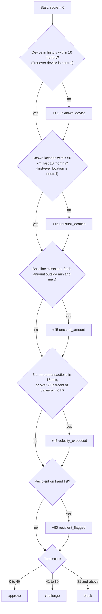
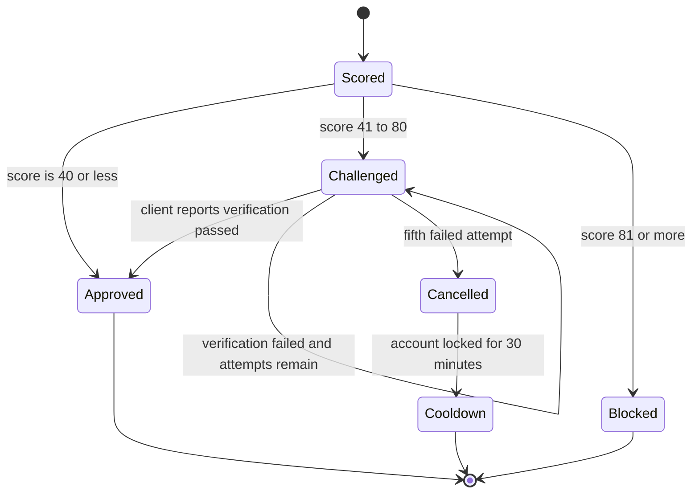

# 03. Risk Engine Design

[← Back to index](../SYSTEM_DESIGN.md) · Previous: [Architecture](02-architecture.md) · Next: [Database design →](04-database-design.md)

## 1. Overview

The risk engine is the heart of Sentinel. It lives in `services/riskEngine.js` as a single function:

```
evaluateTransaction(db, tx)  →  { decision, score, reasons }
```

It receives a database handle and the transaction data, runs five rules, adds up points, and maps the total to a decision. It knows nothing about HTTP. The controller passes in a dedicated transaction connection; tests pass in a fake.

## 2. Input and output

**Input (`tx`)**

| Field | Type | Supplied by |
|---|---|---|
| `userId` | UUID | Calling app |
| `amount` | number (USD) | Calling app |
| `deviceId` | string | Calling app, from the phone |
| `latitude`, `longitude` | numbers | Calling app, from the phone's GPS |
| `recipientAccount` | string | Calling app |
| `currentBalance` | number (USD) | Calling app |

**Output**

| Field | Meaning |
|---|---|
| `decision` | `approve`, `challenge` or `block` |
| `score` | Sum of points from triggered rules |
| `reasons` | Array of rule names that fired, for example `["unknown_device","unusual_location"]` |

## 3. Decision flow



## 4. The rules

### 4.1 Unknown device (`unknown_device`, +45)

| | |
|---|---|
| **Intent** | Catch a stolen card or hijacked account being used from hardware the real owner never used. |
| **Data** | `device_history`: one row per `(user_id, device_id)` with `last_seen_at` |
| **Logic** | Known if the user's device history contains this device and it was seen within the last **10 months**. A different device, or one unseen for over 10 months, is unknown. |
| **Decay** | After 10 months unseen, the device is treated as new again. Trust is never permanent. |
| **Caching** | Result cached in Redis for 1 hour |
| **Edge cases** | A user with no device history at all is on their first transaction. That device is accepted and learned (**trust on first use**), so the rule does not fire. From then on, any device not in their history triggers it. |

### 4.2 Unusual location (`unusual_location`, +45)

| | |
|---|---|
| **Intent** | Catch use from a place the user has never been, including physically impossible jumps. |
| **Data** | `location_history`: latitude, longitude and `last_seen_at` per visit |
| **Logic** | Load all of the user's stored locations. The location is known if **any** stored point is within **50 km** (Haversine distance) **and** was seen within the last **10 months**. |
| **Decay** | Same 10-month window as devices |
| **Caching** | Result cached for 1 hour, keyed by user and the exact coordinates |
| **Edge cases** | No stored locations at all means a first-ever transaction: the location is accepted and learned, and the rule does not fire. Because the key includes exact coordinates, GPS jitter lowers the cache hit rate. |

Distance is calculated with the Haversine formula, which gives great-circle distance in kilometres between two latitude and longitude pairs on a sphere of radius 6,371 km. Straight coordinate subtraction is wrong on a curved Earth.

### 4.3 Unusual amount (`unusual_amount`, +45)

| | |
|---|---|
| **Intent** | Catch spending far outside the user's own normal range. This also defends against a compromised account being drained in many "normal" small transfers, because the range expires. |
| **Data** | `amount_baseline`: one row per user with `min_amount`, `max_amount`, `last_updated_at` |
| **Logic** | If a baseline exists and is **not stale**, flag when `amount < min_amount` or `amount > max_amount`. |
| **Decay** | A baseline is stale if not updated for **6 months**. A stale or missing baseline means this rule is **skipped**: there is nothing reliable to compare against. |
| **Why 6 and not 10 months** | Spending habits shift faster than the phone in someone's hand. |
| **Learning** | After each transaction the worker widens the range with `LEAST` and `GREATEST` and refreshes `last_updated_at`. |

### 4.4 Velocity (`velocity_exceeded`, +45)

| | |
|---|---|
| **Intent** | Catch card-testing bots and rapid draining. |
| **Data** | `transactions`, queried live every time (never cached) |
| **Logic** | Triggers if **either**: 5 or more transactions by this user in the last **15 minutes**, **or** the sum of amounts in the last **6 hours** exceeds **20 percent of `currentBalance`**. |
| **Why never cached** | The whole point is a fresh count. A cached count would let bursts through. |
| **Origin of the 20 percent** | Replaced an early flat "$5,000 in 6 hours" idea, because a flat figure ignores how much money the user actually has. |
| **Not yet implemented** | A minimum floor and maximum ceiling around the percentage, so tiny accounts are not flagged constantly and huge accounts are not given an unlimited allowance. |

### 4.5 Flagged recipient (`recipient_flagged`, +90)

| | |
|---|---|
| **Intent** | Catch payments to accounts already known for fraud. A simple internal version of "this number was reported as spam". |
| **Data** | `flagged_recipients`: global list, not per user |
| **Logic** | Flag if the recipient account is on the list |
| **Decay** | None. The list does not expire. |
| **Why 90** | 90 lands in the `block` band alone. If the user is **knowingly** sending money to a scammer, a face check would pass, because it really is them. Challenging does not help here, so the rule blocks directly. |
| **Caching** | Cached for 1 hour. A "not flagged" answer is stored as the marker string `none`. |

## 5. Scoring and thresholds

| Total score | Decision |
|---|---|
| 0 to 40 | `approve` |
| 41 to 80 | `challenge` |
| 81 and above | `block` |

### How the weights behave

The weights were chosen so that **any single rule alone forces at least a challenge**, instead of needing several to pile up. Four rules weigh 45, which is above the approve ceiling of 40. The recipient rule weighs 90, which is above the block floor of 81.

Because of these particular numbers, the score can only land on a small set of values, so the system behaves like a count of signals:

| Signals triggered | Score | Decision |
|---|---|---|
| None | 0 | approve |
| Exactly one of device, location, amount, velocity | 45 | challenge |
| Any two of those four | 90 | block |
| Three or four of them | 135 or 180 | block |
| Flagged recipient (alone or combined) | 90 or more | block |

The 41 to 80 band is therefore only ever reached by exactly one non-recipient signal. This is intentional for v1: it keeps outcomes easy to explain to an analyst. If finer gradation is wanted later, the weights live in one `POINTS` constant and can be tuned without touching the logic.

## 6. Worked examples

| # | Scenario | Rules fired | Score | Decision |
|---|---|---|---|---|
| 1 | Known phone, usual city, normal amount, calm activity | none | 0 | approve |
| 2 | Same user buys a new phone, everything else normal | unknown_device | 45 | challenge |
| 3 | Known phone, user travelling to a new city | unusual_location | 45 | challenge |
| 4 | Known phone and city, but 6 transactions in 10 minutes | velocity_exceeded | 45 | challenge |
| 5 | New phone **and** a far-away country | unknown_device, unusual_location | 90 | block |
| 6 | Everything normal, but the recipient is on the fraud list | recipient_flagged | 90 | block |
| 7 | Known phone and city, amount 10 times the usual maximum | unusual_amount | 45 | challenge |
| 8 | A brand-new user's first ever transaction | none (trust on first use) | 0 | approve |

Example 8 is trust on first use: with no history there is nothing to compare against, so a user's first device and location are accepted and learned, and everything after that is judged against them.

## 7. Challenge confirmation flow (designed, not yet built)

When Sentinel returns `challenge`, the calling app collects extra proof from the user (fingerprint, OTP, face check). Sentinel never does this itself because it has no access to the device. The client reports only a pass or fail.



Rules agreed for this flow:

1. A client reports the result to `POST /v1/transactions/:id/confirm` with `{ "verified": true|false }`.
2. A transaction allows **5 verification attempts**. Real users make mistakes with lighting, shaky hands and typos, but five failures is a clear signal.
3. After the fifth failure the **transaction is cancelled** and the user is told to try again later.
4. The account then enters a **30-minute cooldown**. During cooldown **other** transactions for that account are blocked; the cancelled one is not queued.
5. If an account hits cooldown **twice within 24 hours**, it is flagged for manual admin review as a likely real attack.
6. Every failed attempt is written to `audit_logs` (`event_type` of `verification_attempt`).
7. History (device, location) is learned only from **approved** transactions. Once this flow exists, a challenge that passes verification should also be learned from.

## 8. Adding a new rule

1. Add a data-access function in `db/` that answers the question (cache it if the answer is stable).
2. Add a constant to `POINTS`.
3. Add a block in `evaluateTransaction` that adds points and pushes a reason string.
4. Add a unit test in `tests/riskEngine.test.js` with a mocked database.
5. Document the rule in section 4 above.

No other file needs to change.

## 9. Design notes

- **Sequential execution.** Rules currently run one after another, which is required for the single locked connection. Independent reads could later run in parallel on the pool where no lock is needed.
- **Explainability.** Each rule appends a plain string to `reasons`, so an analyst can see exactly why a decision was made.
- **Determinism.** The same inputs and stored history always produce the same decision.