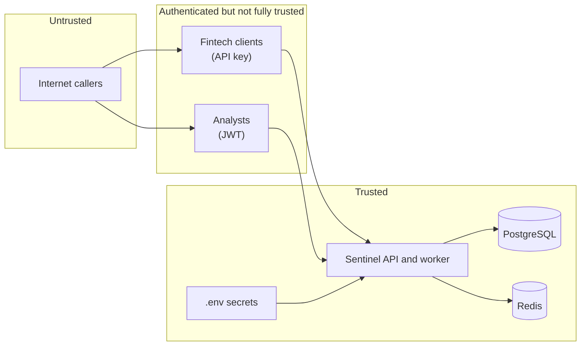
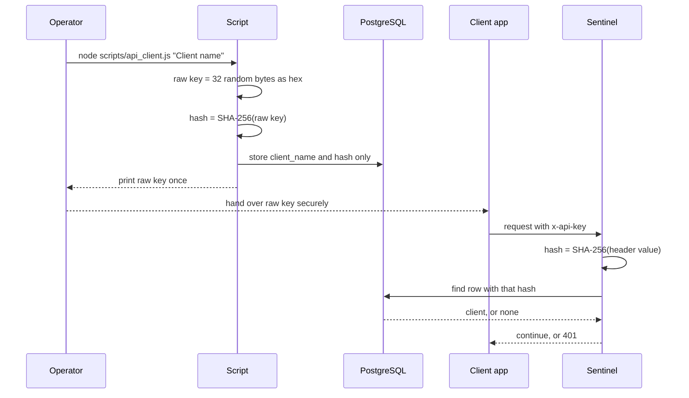
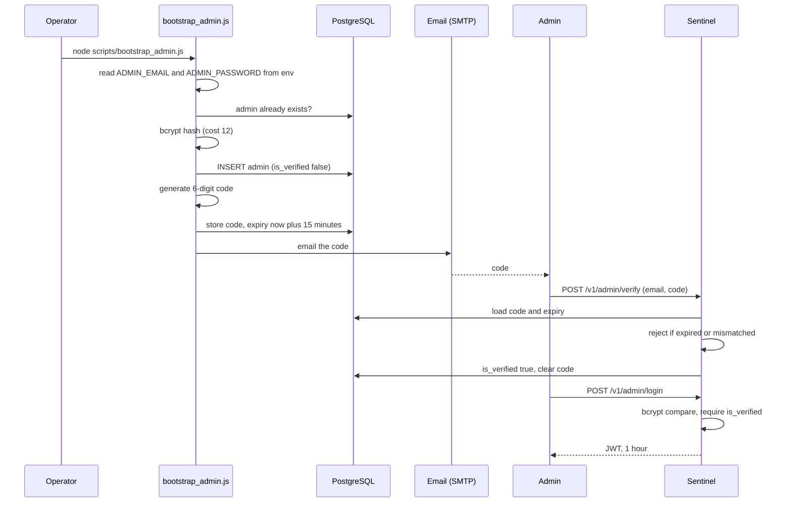
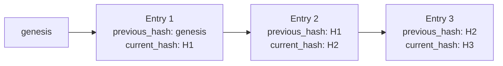

# 06. Security Design

[← Back to index](../SYSTEM_DESIGN.md) · Previous: [API design](05-api-design.md) · Next: [Reliability and performance →](07-reliability-and-performance.md)

## 1. Security objectives

1. Only **registered fintech clients** can submit transactions.
2. Only **verified, authenticated analysts** can read flagged data or override decisions.
3. Sensitive data is **unreadable if the database leaks**.
4. Decisions and overrides leave **tamper-evident evidence**.
5. Hostile input cannot alter queries or crash the service.

## 2. Trust boundaries



A fintech client is authenticated, but Sentinel still validates everything it sends. It also cannot verify that device ID or GPS values are honest. That is an accepted limit of the model.

## 3. Assets

| Asset | Why it matters |
|---|---|
| API keys | Allow submitting transactions as a client |
| Admin credentials and JWTs | Allow reading flagged data and overriding decisions |
| `recipient_account` | Sensitive financial identifier |
| `ENCRYPTION_KEY` | Decrypts every stored recipient account |
| `JWT_SECRET` | Forges admin tokens if leaked |
| Audit log | Evidence; its integrity is the value |
| Transaction history, device and location data | Personal and behavioral data |

## 4. Authentication

### 4.1 Fintech clients: API keys



- The **raw key is shown once and never stored.** A database leak yields only hashes.
- Keys are random 256-bit values, so a fast hash is safe.
- **Why SHA-256 and not bcrypt here:** bcrypt output differs on every run (random salt), so it can only be checked with `compare()` against a row you have already found. API keys must be found **by** the hash, so a deterministic hash is required. Bcrypt suits passwords, where the email is the lookup key.
- Not yet built: key rotation, expiry, per-client revocation.

### 4.2 Analysts: password, email verification, JWT

**Provisioning.** There is no public admin registration endpoint. An operator runs a bootstrap script that reads `ADMIN_EMAIL` and `ADMIN_PASSWORD` from the environment, hashes the password, inserts the admin and emails a code.



| Control | Detail |
|---|---|
| Password hashing | bcrypt, cost factor 12 |
| Verification code | 6 digits, expires in 15 minutes, cleared on success |
| Login gate | Unverified admins cannot log in |
| Token | JWT signed with `JWT_SECRET`, payload `{ id, role }`, expires in 1 hour |
| Secrets | Bootstrap credentials come from environment variables, never from source or migrations |

## 5. Authorization

| Endpoint | No credential | API key | Admin JWT |
|---|---|---|---|
| `POST /v1/transactions` | 401 | Allowed | 401 |
| `GET /v1/transactions/:id` | 401 | 401 | Allowed |
| `GET /v1/flagged` | 401 | 401 | Allowed |
| `POST /v1/flagged/:id/review` | 401 | 401 | Allowed |
| `GET /v1/users/:id/risk-profile` | 401 | 401 | Allowed |
| `POST /v1/admin/verify`, `/login` | Allowed | Allowed | Allowed |

**Middleware chain on admin routes:** `authenticateToken` (reads the Bearer token, verifies the signature and expiry, attaches `req.user`) then `requireRole('admin')` (compares `req.user.role`).

The role mechanism supports multiple tiers (for example analyst versus senior admin). Today only one role exists, so the mechanism is built but the tiering is not.

## 6. Data protection

### 6.1 Encryption at rest: `recipient_account`

| Property | Value |
|---|---|
| Algorithm | AES-256-CBC |
| Key | 32 random bytes in `ENCRYPTION_KEY` (64 hex characters) |
| IV | A fresh random 16 bytes for every encryption |
| Stored format | `<iv hex>:<ciphertext hex>` |
| Encrypt | In `insertTransaction`, before the row is written |
| Decrypt | In the admin read routes, just before the response is sent |

Because the IV is random, encrypting the same account twice gives different ciphertext, which prevents pattern matching. The IV is not secret and is stored beside the ciphertext.

**Encryption versus hashing.** Hashing is one-way and suits values you only ever compare (passwords, API keys). Encryption is reversible and suits values you must read back, such as an account number shown to an analyst. Using hashing here would make review impossible.

Limits recorded honestly:

- CBC provides **confidentiality but not integrity**. AES-256-GCM would also detect tampering and is the recommended upgrade (K-13).
- There is no key rotation procedure yet.
- Latitude, longitude, device ID and amounts are stored in plain text because the rules need them. Field-level protection was scoped to the most sensitive identifier.

### 6.2 Hashing summary

| What | Algorithm | Why |
|---|---|---|
| Admin passwords | bcrypt, cost 12 | Deliberately slow, salted |
| API keys | SHA-256 | Deterministic, needed for lookup; keys are high-entropy |
| Audit chain | SHA-256 | Standard collision-resistant hash |

## 7. Tamper-evident audit log

Every decision and admin override appends a row to `audit_logs`. Rows are linked into a chain:



**Algorithm (in `db/auditLogs.js`)**

```
previous_hash = current_hash of the newest entry, or "genesis" if the table is empty
payload       = JSON(transactionId, eventType, decision, reasons, timestamp) + previous_hash
current_hash  = SHA-256(payload)
insert the row with both hashes
```

**Why it works.** If someone edits an old row, its hash no longer matches what the next row recorded as `previous_hash`. The break exposes the tampering. This is the same idea a blockchain uses to link blocks.

**What is built and what is not:**

- Built: chain creation on every write.
- Not built: a verifier that walks the chain and reports breaks.
- Two refinements are needed before the chain is fully verifiable (K-07): the timestamp used in the hash must also be the one stored in `created_at`, and the read of the latest hash must be serialized so concurrent writes cannot fork the chain.

## 8. Input handling

| Threat | Control |
|---|---|
| SQL injection | Every query uses parameter placeholders (`$1`, `$2`). User input never becomes SQL text. |
| Malformed or hostile fields | `validateTransaction` checks types, ranges, UUID format and non-empty strings before the controller runs |
| Oversized or malformed JSON | Express JSON body parsing rejects invalid JSON |
| Error leakage | Handlers return generic messages; details go to the server log only |

## 9. Threat model

| # | Threat | Likelihood | Mitigation | Residual risk |
|---|---|---|---|---|
| T1 | Unauthenticated user submits transactions | High | API-key middleware | Stolen key remains valid until manually removed |
| T2 | Unauthenticated user reads flagged data | High | JWT and role middleware on all admin routes | None known |
| T3 | Database leak exposes secrets | Medium | Hashed passwords and API keys; encrypted recipient accounts | Plain-text device, location and amount data |
| T4 | Leaked `ENCRYPTION_KEY` or `JWT_SECRET` | Medium | Kept in `.env`, excluded from Git | No rotation procedure |
| T5 | SQL injection | High | Parameterized queries throughout | Low |
| T6 | Duplicate or replayed request double-counted | Medium | Idempotency key plus unique constraint | Concurrent same-key race (see reliability doc) |
| T7 | Audit log edited after the fact | Medium | Hash chain | No verifier yet |
| T8 | Brute-forcing the 6-digit code or login | Medium | Code expiry (15 minutes) | **No attempt limit or rate limiting** |
| T9 | Analyst impersonation in a review | Low | Token-based identity on admin routes | `reviewedBy` is still free text (K-08) |
| T10 | Spoofed device or GPS values from a malicious client | Medium | Trusted-client model | Sentinel cannot verify honesty |
| T11 | Admin account enumeration through login errors | Low | None | 404 versus 401 reveals valid emails |
| T12 | Redis compromise poisons cached answers | Low | Redis assumed on a private network | No Redis auth configured locally |

## 10. Secrets management

| Secret | Location | Rule |
|---|---|---|
| `DATABASE_URL` | `.env` | Not committed |
| `ENCRYPTION_KEY` | `.env` | 64 hex characters; never reused across environments |
| `JWT_SECRET` | `.env` | Long and random |
| `EMAIL_USER`, `EMAIL_PASS` | `.env` | An app-specific password, never the account password |
| `ADMIN_EMAIL`, `ADMIN_PASSWORD` | `.env` | Used once by the bootstrap script |

`.env` is listed in `.gitignore`. Any secret that has ever appeared in a chat, screenshot or commit must be treated as exposed and regenerated before real use.

## 11. Pre-deployment security checklist

- [ ] Generate fresh `ENCRYPTION_KEY`, `JWT_SECRET`, database password and admin password
- [ ] Confirm `.env` is not tracked: `git ls-files | grep env` returns nothing
- [ ] Terminate HTTPS in front of the API
- [ ] Add rate limiting on login, verify and scoring endpoints
- [ ] Add security headers (for example the `helmet` package) and a restrictive CORS policy
- [ ] Require a password for Redis and keep it off public networks
- [ ] Move to AES-256-GCM and plan key rotation
- [ ] Put a unique index on `api_clients.hashed_key`
- [ ] Take the review identity from the token and populate `audit_logs.admin_id`