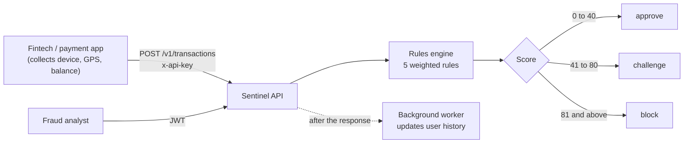

# Sentinel: System Design

| | |
|---|---|
| **Project** | Sentinel, a real-time transaction fraud-scoring API |
| **Author** | Ayo ([@Xylem56](https://github.com/Xylem56)) |
| **Version** | 1.0 |
| **Last updated** | October 2026 |
| **Status** | Core system implemented; open hardening items are tracked in [Known limitations and roadmap](docs/10-known-limitations-and-roadmap.md) |

---

## 1. Executive summary

Sentinel is a backend service that a fintech or payment company calls **before** it completes a payment. The caller sends the details of the attempt (who, how much, from which device, from where, to whom). Sentinel compares that attempt against what it already knows about the user and answers within the same request with one of three decisions:

| Decision | Meaning for the calling app |
|---|---|
| `approve` | Looks normal. Let the payment continue. |
| `challenge` | Suspicious. Ask the user for extra proof (fingerprint, OTP, face check) before continuing. |
| `block` | Too risky. Stop the payment. |

Every decision is returned with a numeric **risk score** and the **reasons** that produced it, and is written to a tamper-evident audit log.

Sentinel is deliberately **not** a payment system and **not** a login system. It never moves money, never holds balances, and never authenticates end users. It only judges the data it is given.

## 2. The problem it solves

A stolen card or a hijacked phone usually does not look like the real owner. It appears on a new device, in an unusual place, for an unusual amount, at an unusual speed, or sends money to an account already known for fraud.

The design was inspired by how consumer banking apps behave: a user who normally sends small amounts attempts a large one, and the app interrupts with a face-verification step **before the PIN screen**. The ordering matters. Once a PIN is entered, almost nothing can stop the payment, so the risk check has to happen first. That requirement shaped the whole system: the decision must be **synchronous** and **fast**.

## 3. System at a glance

## 4. Design principles

1. **Decide before the money moves.** The scoring path is synchronous. Anything that can wait is pushed to a background queue.
2. **Judge the person against their own history.** Suspicion is relative. A $2,000 transfer is normal for one user and alarming for another.
3. **Every signal matters.** Weights are calibrated so that a single triggered rule is enough to force a challenge, while stacked signals escalate to a block.
4. **Sentinel only trusts what it is told.** It has no camera, GPS or account access. The calling app supplies the signals; Sentinel supplies the judgement.
5. **Leave evidence.** Every decision and every admin override is recorded in an append-only, hash-chained audit log.
6. **Fail safe on data, not on trust.** Sensitive values are encrypted or hashed at rest, and all SQL is parameterized.

## 5. Documentation map

| # | Document | What it covers |
|---|---|---|
| 1 | [Requirements and scope](docs/01-requirements-and-scope.md) | Actors, functional and non-functional requirements, what is in and out of scope, engineering objectives |
| 2 | [Architecture](docs/02-architecture.md) | Components, process model, project structure, request lifecycle, technology choices |
| 3 | [Risk engine design](docs/03-risk-engine-design.md) | The five rules, scoring, thresholds, worked examples, the challenge and cooldown flow |
| 4 | [Database design](docs/04-database-design.md) | ER diagram, every table and column, indexes, migrations, key queries, data classification |
| 5 | [API design](docs/05-api-design.md) | Conventions and a full reference for every endpoint, with requests, responses and errors |
| 6 | [Security design](docs/06-security-design.md) | Authentication, authorization, encryption, hashing, audit chain, threat model |
| 7 | [Reliability and performance](docs/07-reliability-and-performance.md) | Idempotency, concurrency control, Redis caching, the job queue, scaling path |
| 8 | [Testing strategy](docs/08-testing-strategy.md) | Current test suite, mocking approach, planned tests, manual smoke test |
| 9 | [Decision log](docs/09-decision-log.md) | Every major design decision with the alternatives considered and why |
| 10 | [Known limitations and roadmap](docs/10-known-limitations-and-roadmap.md) | Open issues by severity, and the phased plan to close them |

## 6. Implementation status

| Component | Status | Notes |
|---|---|---|
| `POST /v1/transactions` scoring endpoint | Implemented | API-key protected, input validated |
| Five scoring rules | Implemented | First-ever device and location are accepted (trust on first use) |
| Idempotency | Implemented | Caller-supplied key plus a unique constraint |
| DB transaction with row locking | Implemented | Gap when a user has no recent rows (K-06) |
| Hash-chained audit log | Implemented | No verifier tool yet (K-07) |
| Redis caching | Implemented | Four read paths cached for one hour |
| Queue and background worker | Implemented | Learns only from approved transactions |
| Encryption of `recipient_account` | Implemented | AES-256-CBC |
| API-key authentication | Implemented | SHA-256 hashed keys |
| Admin onboarding, verification, login, JWT | Implemented | Bootstrap script, emailed code, bcrypt |
| Role-based access control | Partial | One role (`admin`) enforced; tiers not built |
| Admin review and override | Implemented | Hardening needed (K-08) |
| Risk profile and transaction lookup endpoints | Implemented | Admin only |
| Challenge confirmation, retry limit, cooldown | Designed only | See [03](docs/03-risk-engine-design.md#7-challenge-confirmation-flow-designed-not-yet-built) |
| Rate limiting | Not planned for v1 | See [decision log](docs/09-decision-log.md) |
| Automated tests | Partial | Rules engine unit tests; integration tests planned |

Status labels used throughout these documents:

- **Implemented**: exists in the codebase and was exercised.
- **Partial**: some of the behavior exists.
- **Designed only**: specified here, not yet coded.

## 7. Glossary

| Term | Meaning |
|---|---|
| **Calling app / client** | The fintech application that integrates Sentinel and sends transactions for scoring |
| **Transaction** | One payment attempt submitted for a decision |
| **Signal** | A fact about the attempt used for scoring (device, location, amount, speed, recipient) |
| **Rule** | A check that inspects one signal and adds points to the risk score if it looks wrong |
| **Risk score** | The sum of points from all triggered rules |
| **Baseline** | A user's usual spending range, learned from past transactions |
| **Trust window / decay** | How long a known device, location or baseline stays trusted without being seen again |
| **Velocity** | How many transactions, or how much money, move within a short window |
| **Challenge** | An outcome asking the calling app to collect extra proof from the user |
| **Idempotency key** | A caller-generated unique value that makes retries of the same request safe |
| **Audit log** | The append-only record of decisions and admin actions, linked by hashes |
| **Cache-aside** | Read from the cache first, fall back to the database, then store the result in the cache |