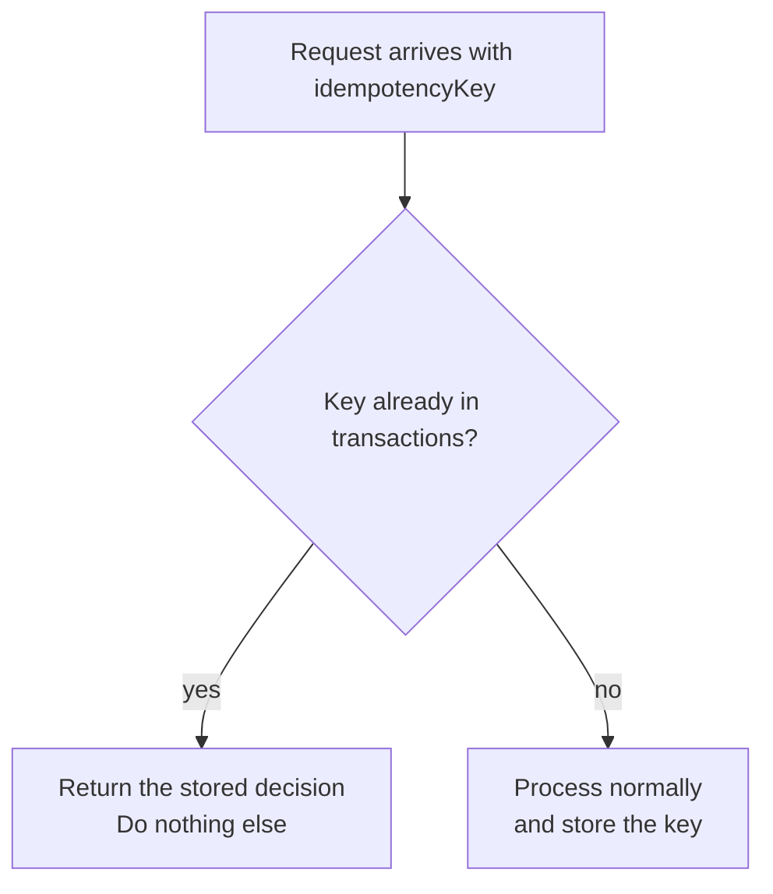
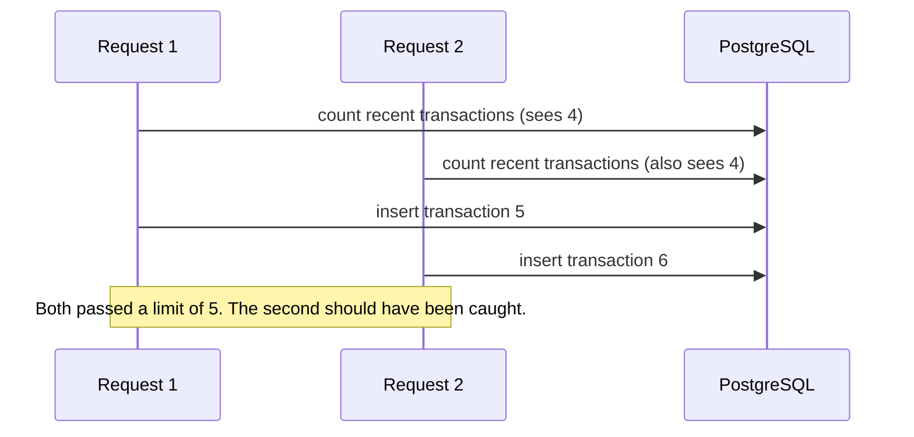
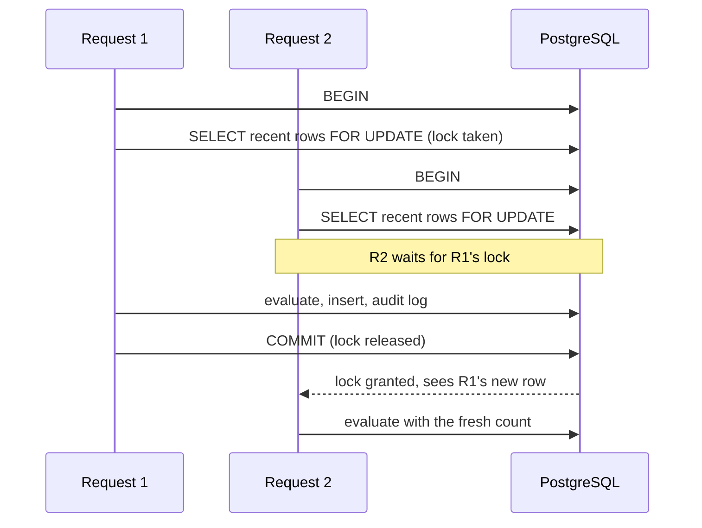
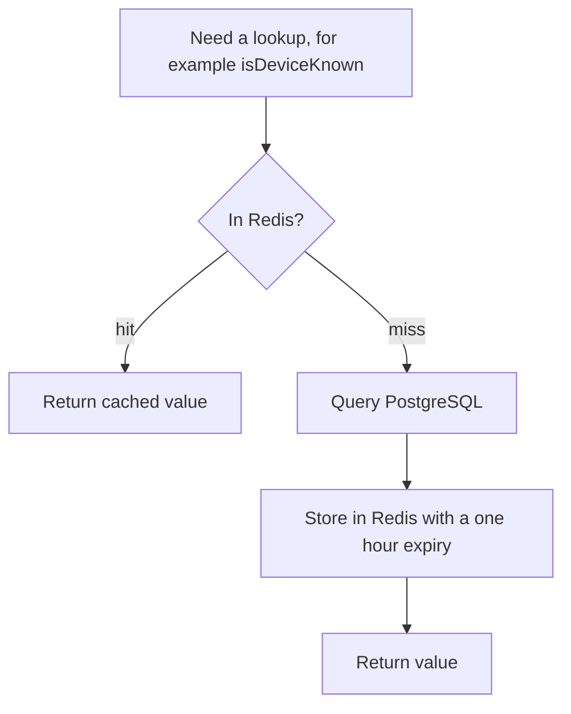
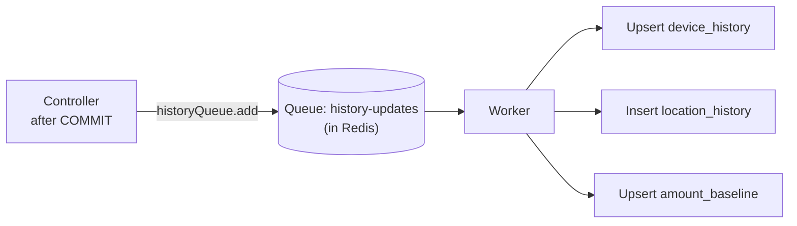

# 07. Reliability and Performance

[← Back to index](../SYSTEM_DESIGN.md) · Previous: [Security design](06-security-design.md) · Next: [Testing strategy →](08-tests.md)

## 1. Overview

A fraud decision sits inside a payment flow, so it must be **correct**, **repeatable** and **fast**. Four mechanisms deliver that:

| Mechanism | Problem it solves |
|---|---|
| Idempotency | Network retries must not be counted twice |
| Database transaction with row lock | Simultaneous requests must not slip past a limit together |
| Redis caching | Repeated lookups should not hit PostgreSQL every time |
| Background queue | Slow bookkeeping must not delay the decision |

## 2. Idempotency

### The problem

A client sends a transaction, the network drops, the response never arrives, and the client retries. The first request actually succeeded. Without protection, Sentinel would score it twice, write two audit entries, and count it twice toward the velocity limit.

### The design

The **caller** generates a unique `idempotencyKey` per payment attempt. The caller must generate it because only the caller knows whether two requests are retries of one attempt or two real attempts.

Two layers protect against duplicates:

1. **Application check.** The controller looks the key up first and replays the stored result if found.
2. **Database constraint.** `transactions.idempotency_key` is `UNIQUE`, so Postgres itself refuses a second insert with the same key.

### Remaining race

The application check runs **before** the lock and transaction begin. If two requests with the same new key arrive at the same instant, both may pass the check; the unique constraint then rejects the second insert, which surfaces as a rolled-back 500. No duplicate row can exist, but the second caller sees an error instead of a replay. A refinement is to catch the unique-violation error and return the stored result.

## 3. Concurrency control

### The problem

Both requests read the count before either wrote its row, so the velocity rule was bypassed.

### The design

The check-and-insert sequence runs inside one **database transaction** on one **dedicated connection**, with the user's recent rows locked:

| Step | SQL or code | Purpose |
|---|---|---|
| 1 | `pool.connect()` | Take one dedicated connection. A locking sequence must stay on the same connection. |
| 2 | `BEGIN` | Start an atomic unit of work |
| 3 | `SELECT id FROM transactions WHERE user_id = $1 AND created_at >= NOW() - INTERVAL '15 minutes' FOR UPDATE` | Lock the user's recent rows. Anyone else doing the same waits. |
| 4 | Evaluate rules, insert the transaction, write the audit log, all via the same connection | Everything happens under the lock |
| 5 | `COMMIT`, or `ROLLBACK` on error | Make it permanent, or undo it entirely |
| 6 | `client.release()` in a `finally` block | Always return the connection. Forgetting this leaks connections until the pool is exhausted. |

Every data-access function simply accepts a handle with `.query()`. Passing the dedicated client instead of the pool required no changes inside those functions.

**Sequential by necessity.** One connection runs one query at a time, so these steps are strictly ordered.

### Known gap

`FOR UPDATE` locks rows that **exist**. If a user has **no** transactions in the last 15 minutes, nothing is locked, and two simultaneous first requests can still both proceed. PostgreSQL has no "gap lock" for absent rows. Sturdier options are to lock the user's row in `users`, or use a transaction-scoped advisory lock keyed on the user ID (K-06).

## 4. Caching with Redis

### Pattern: cache-aside

### What is cached

| Function | Key | Value | TTL |
|---|---|---|---|
| `isDeviceKnown` | `device-known:<userId>:<deviceId>` | `"true"` or `"false"` | 1 hour |
| `isLocationKnown` | `is-location-known:<userId>:<lat>:<lon>` | `"true"` or `"false"` | 1 hour |
| `getAmountBaseline` | `amount-baseline:<userId>` | JSON object, or JSON `null` | 1 hour |
| `isRecipientFlagged` | `flagged-recipient:<account>` | JSON row, or the marker `none` | 1 hour |

Redis stores only strings, so booleans are written as the words `"true"`/`"false"` and objects go through `JSON.stringify` and `JSON.parse`. For recipients, "not flagged" is stored as `none` because JSON `null` becomes the string `"null"`, which is easy to confuse with "nothing cached yet".

### What is deliberately not cached

| Function | Reason |
|---|---|
| `getRecentTransactionCount`, `getBalanceMovedInWindow` | Velocity depends on **fresh** data. A cached count would let bursts through. |
| Inserts and audit writes | Writes are never cached |

### Trade-offs

| Issue | Detail |
|---|---|
| **Staleness** | Answers can be up to an hour old. A device learned by the worker may still read as unknown from cache for up to an hour. |
| **No invalidation** | The worker does not clear cached keys after updating history (K-11). |
| **Hit rate** | The location key includes exact coordinates, so small GPS differences miss the cache. |
| **Redis down** | A Redis failure currently throws and fails the request. A try/catch that falls back to PostgreSQL would make this graceful (K-10). |

## 5. Background queue (BullMQ)

### What moves off the critical path

Learning from a transaction (remembering the device, the place, the amount) does not affect the decision already being returned, so it runs afterward.

The decision itself is never queued. It must be returned before the payment completes.

### Job

| Field | Value |
|---|---|
| Queue name | `history-updates` |
| Job name | `update-history` |
| Payload | `userId`, `deviceId`, `latitude`, `longitude`, `amount` |

### Worker behavior

| Table | Operation | Repeat-safe? |
|---|---|---|
| `device_history` | `INSERT ... ON CONFLICT (user_id, device_id) DO UPDATE SET last_seen_at = NOW()` | Yes |
| `location_history` | Plain `INSERT` of a new row | No: a repeated job adds a duplicate row |
| `amount_baseline` | `INSERT ... ON CONFLICT (user_id) DO UPDATE` using `LEAST` and `GREATEST` | Yes |

`LEAST(current_min, new_amount)` and `GREATEST(current_max, new_amount)` make the range widen to include every amount seen, and `last_updated_at` refreshes the 6-month decay clock.

### Delivery semantics

- BullMQ delivers each job **at least once**, so job handlers should tolerate repeats.
- Retry policies and dead-letter handling were descoped. The worker logs failed jobs only.
- The worker runs as a **separate process**, so slow bookkeeping never competes with request handling.

### Learning rule

The job is enqueued **only when the decision is `approve`**. A device or place from a challenged or blocked attempt is never learned, so an attacker cannot become "known" by being refused. Once the challenge confirmation flow exists, a challenge that passes verification should also be learned from.

## 6. Performance characteristics

Per scoring request the system performs, in order:

1. One API-key lookup
2. One idempotency lookup
3. One locking read
4. Up to six rule lookups (four cache-aside, two live velocity queries)
5. Two inserts (transaction, audit log) and a read for the previous audit hash
6. One queue add

Most repeated lookups are served from Redis. The two velocity queries are indexed on `(user_id, created_at)`.

Not measured yet: latency percentiles, throughput, pool saturation. Rules currently run sequentially; independent cached lookups could run concurrently if the locking requirement did not pin everything to one connection.

## 7. Scaling path

| Stage | Change |
|---|---|
| 1. More API capacity | Run several stateless API instances behind a load balancer. All state is in PostgreSQL and Redis. |
| 2. More background capacity | Run several workers, or raise worker concurrency |
| 3. Database load | Read replicas for admin queries; partition `transactions` by time |
| 4. Data growth | Prune `location_history`, archive old audit rows |
| 5. Cache | Redis with authentication and persistence settings suited to the deployment |

## 8. Failure modes

| Failure | Current behavior | Preferred behavior |
|---|---|---|
| PostgreSQL error mid-request | `ROLLBACK`, generic 500 | Same |
| Redis down | Request fails | Fall back to PostgreSQL |
| Worker not running | Jobs wait in the queue and are processed later; history lags | Alert on queue depth |
| Worker job fails | Logged, no retry | Bounded retries and a dead-letter queue |
| Duplicate same-key race | Second request rolled back with 500 | Catch the unique violation and replay |
| Email provider down | Bootstrap script errors after the admin row exists | Idempotent re-send of the code |