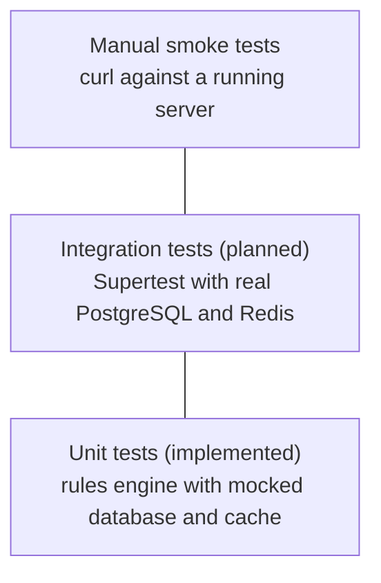
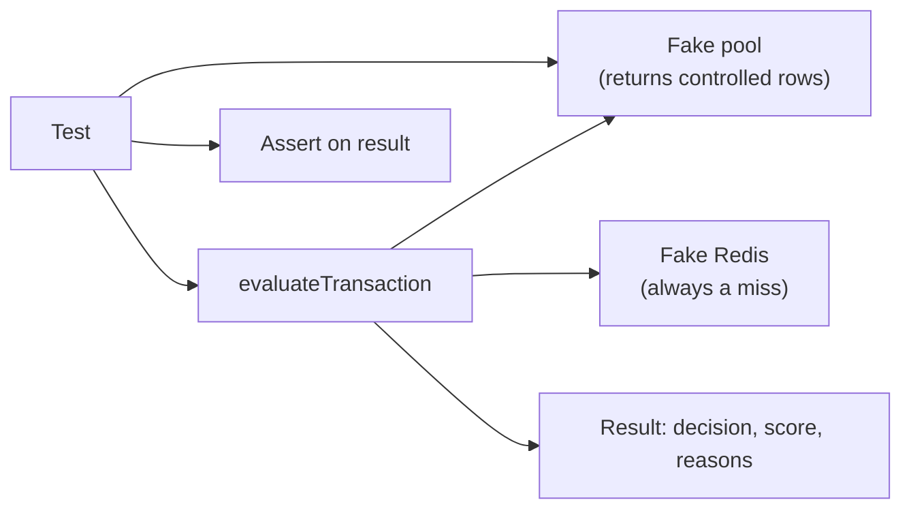

# 08. Testing Strategy

[← Back to index](../SYSTEM_DESIGN.md) · Previous: [Reliability and performance](07-System_Quality.md) · Next: [Decision log →](09-decision-log.md)

## 1. Goals

- Prove the **scoring logic** is correct: each rule fires when it should and stays quiet when it should.
- Prove the **thresholds** map scores to the right decisions.
- Catch regressions when rules or weights change.
- Over time, prove the **security and concurrency guarantees**, not only the happy path.

## 2. Test pyramid



Most tests should be fast unit tests. A small number of integration tests cover what mocks cannot: locking, constraints and HTTP-level security.

## 3. Tooling

| Tool | Role |
|---|---|
| Jest | Test runner and assertions |
| Supertest | Sends HTTP requests to the Express app in-process (reserved for integration tests) |
| `jest.mock` | Replaces Redis with a fake in unit tests |
| `jest.setup.js` | Loads `.env` before every test file so modules that read `process.env` at import time work |

`package.json` configuration:

```json
"scripts": { "test": "jest" },
"jest": { "setupFiles": ["./jest.setup.js"] }
```

Run with `npx jest`.

## 4. How the unit tests work

The rules engine only calls `.query()` on whatever handle it is given. Tests pass a **fake pool** whose `query` function returns canned rows depending on which table name appears in the SQL text. Redis is mocked so every lookup is a cache miss, which means results never depend on what an earlier run cached.



Every test has three parts: **set up** the fake data, **run** the real function, **assert** on the outcome.

## 5. Current suite: `tests/riskEngine.test.js`

| # | Test | Verifies |
|---|---|---|
| 1 | Approves a clean transaction | Known device and location give score 0 and `approve` |
| 2 | Unknown device forces a challenge | Rule fires, reason recorded, decision is `challenge` |
| 3 | Unusual location forces a challenge | Far-away stored location triggers the rule |
| 4 | Amount outside baseline forces a challenge | Personal range comparison works |
| 5 | Too many recent transactions triggers velocity | Count of 6 triggers the rule |
| 6 | Flagged recipient is blocked outright | One rule alone reaches `block` |
| 7 | Stacked signals escalate to block | Device plus location gives score 90 and `block` |

These tests surfaced a real defect during development: the location rule had not been wired into `evaluateTransaction`, which two tests caught.

## 6. Planned tests

Listed in priority order.

| Priority | Area | Test |
|---|---|---|
| 1 | Authentication | Admin routes return 401 with no token and 403 with a bad token or wrong role |
| 1 | Authentication | `POST /v1/transactions` returns 401 with no key or an unknown key |
| 1 | Idempotency | The same key sent twice returns the same response and creates one row |
| 2 | Validation | Negative amount, string amount, bad UUID, out-of-range coordinates, missing fields all return 400 |
| 2 | SQL injection | Hostile input such as `'; DROP TABLE users;--` is stored or rejected as plain data and the tables remain |
| 2 | Encryption | `decrypt(encrypt(x)) === x`; two encryptions of the same value differ |
| 3 | Distance | Known coordinate pairs give the expected Haversine kilometres |
| 3 | Audit chain | Each entry's `previous_hash` equals the prior entry's `current_hash` |
| 3 | Concurrency | Fire parallel requests for one user against a real database and confirm the velocity limit holds |
| 3 | Worker | A job upserts `device_history` and widens `amount_baseline` correctly |

Integration tests need setup and teardown: a separate test database, and closing the pool and Redis client in `afterAll` so Jest can exit cleanly.

## 7. Manual smoke test

Run against a live server with the worker started.

| Step | Command idea | Expected |
|---|---|---|
| 1 | Score a transaction without `x-api-key` | 401 `API key required` |
| 2 | Score with a wrong key | 401 `Invalid API key` |
| 3 | Score with a valid key, new device | 200, `challenge` or `block` with reasons |
| 4 | Repeat step 3 with the same `idempotencyKey` | Identical response, no new row |
| 5 | Call `GET /v1/flagged` with no token | 401 |
| 6 | Verify, then log in as the admin | Token returned |
| 7 | Call `GET /v1/flagged` with the token | List with decrypted recipient accounts |
| 8 | Send a negative `amount` | 400 |
| 9 | Check the worker terminal | `History updated for user ...` |

## 8. Quality gates

- All unit tests pass before any commit to the main branch.
- A bug fix includes a test that fails without the fix.
- A change to a rule weight or threshold updates the examples in [Risk engine design](03-risk-engine-design.md).

## 9. Known testing caveats

- Jest may print "did not exit one second after the test run" when a real Redis or database connection stays open. Mocking Redis in unit tests removes this; integration tests must close their connections.
- Unit tests prove logic, not security. A passing suite says nothing about whether routes are protected until the authentication tests above exist.